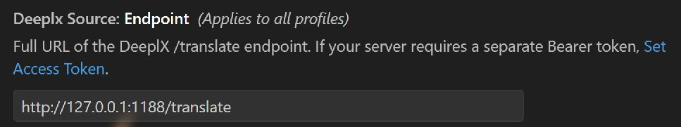
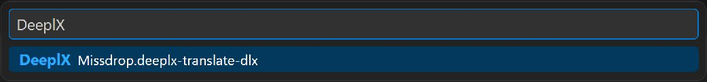

# DeeplX for Comment Translate

Translate comments and selected text through [Comment Translate](https://marketplace.visualstudio.com/items?itemName=intellsmi.comment-translate) using your DeeplX server.

## Use

1. In VS Code **Settings**, search for `deeplxSource.endpoint` and enter your full `/translate` URL.

   

2. Open the Command Palette with **Ctrl+Shift+P** (Windows/Linux) or **⌘⇧P** (macOS). If your server requires a separate Bearer token, run **DeeplX: Set Access Token**.

3. Run **Comment Translate: Change translate source** and select **DeeplX**.

   

4. Hover over a comment or select text and use Comment Translate.
