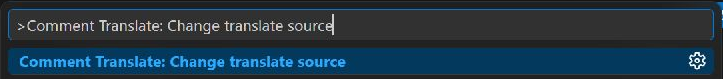

# DeeplX for Comment Translate

Use your DeeplX server to translate comments and selected text in VS Code through [Comment Translate](https://marketplace.visualstudio.com/items?itemName=intellsmi.comment-translate).

## Requirements

Install [Comment Translate](https://marketplace.visualstudio.com/items?itemName=intellsmi.comment-translate) and make sure your DeeplX server is running.

## Use

1. Open the Command Palette and run **DeeplX: Set Endpoint**. Enter the full address of your server’s `/translate` endpoint. You can also edit **DeeplX Source: Endpoint** in the VS Code Settings UI. The default is `http://127.0.0.1:1188/translate`.

2. If your server requires a token, open the Command Palette and run **DeeplX: Set Access Token**. Use an HTTPS endpoint when sending a token to a remote server. Set the token separately on each machine.

3. In the Command Palette, run **Comment Translate: Change translate source**.

   

4. Select **DeeplX**.

   

5. Hover over a comment or select text and use Comment Translate to translate it. To change languages, run **Comment Translate: Change translate target language**.

## Extension Settings

- `deeplxSource.endpoint` — The full URL of your server’s `/translate` endpoint.
- **DeeplX: Set Access Token** and **DeeplX: Clear Access Token** — Save or remove the token on this machine.
